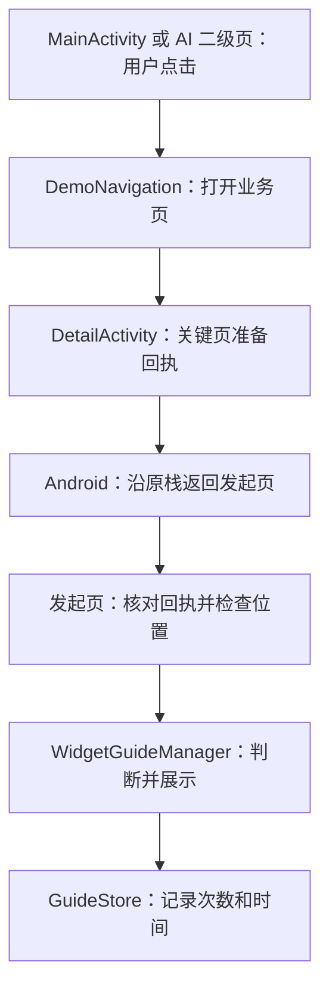
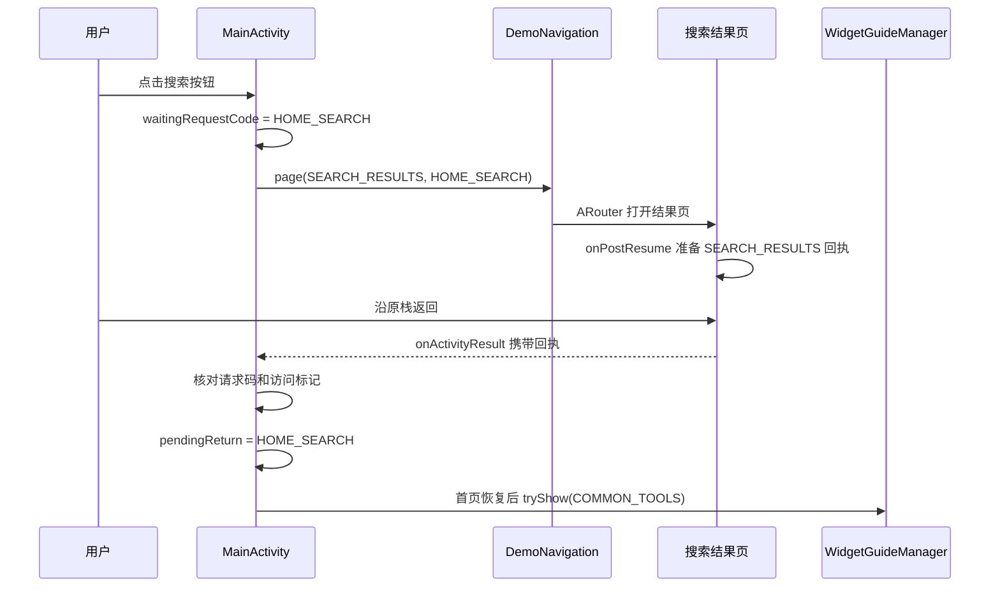
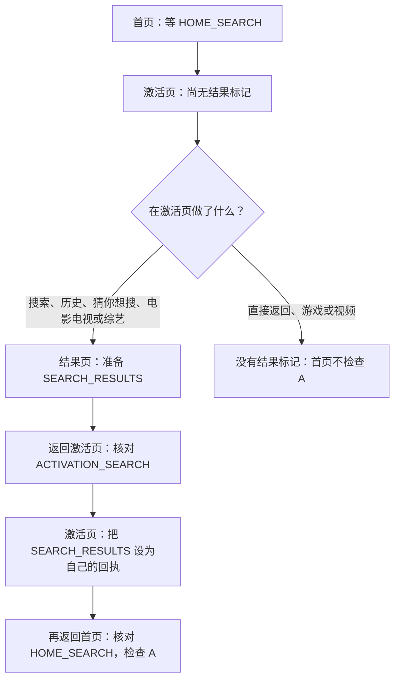
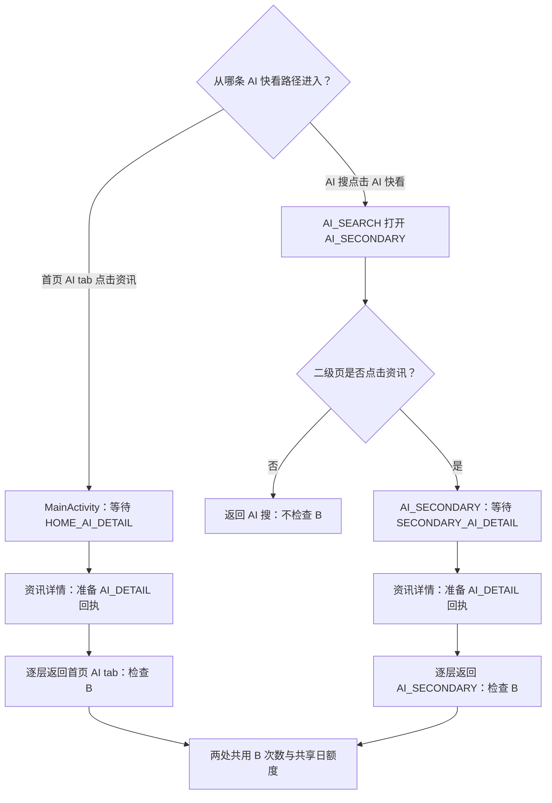
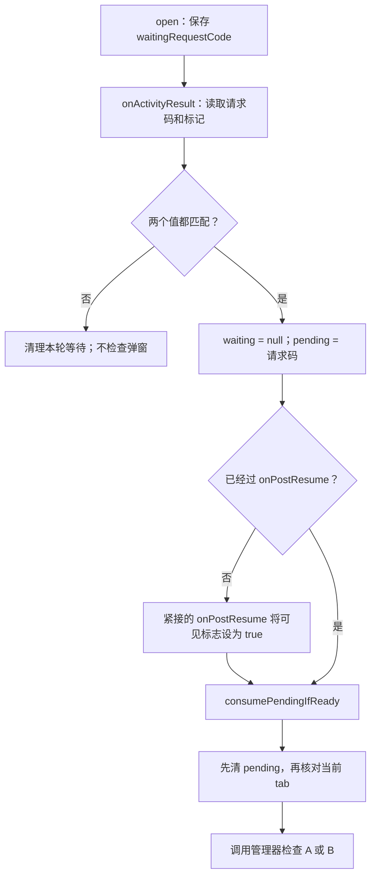
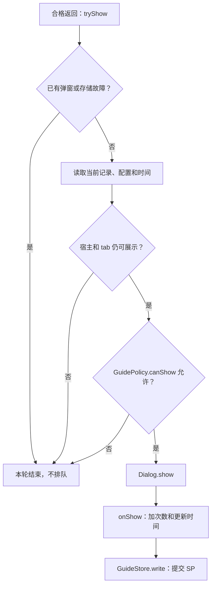
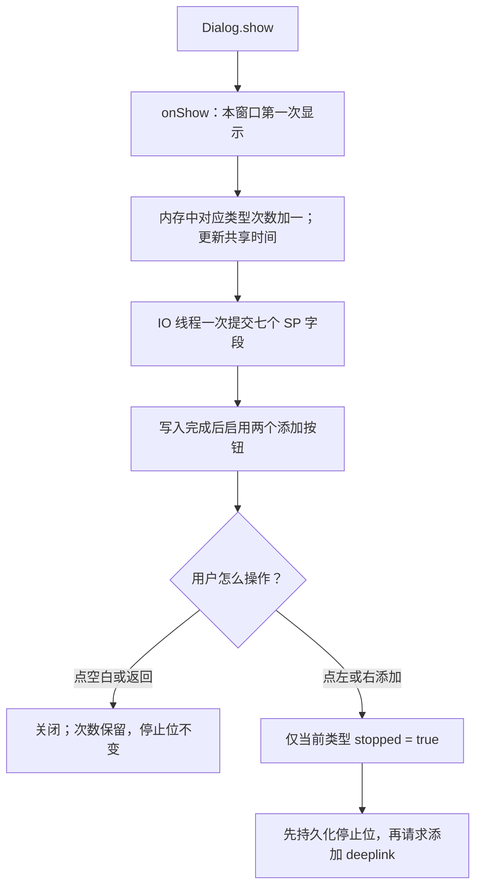
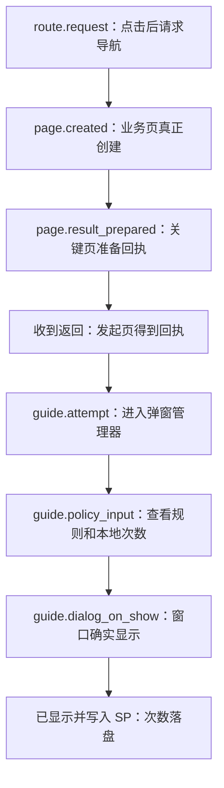
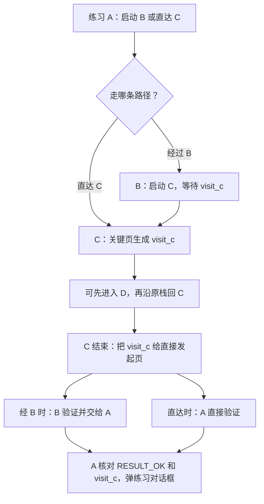

# B 分支代码导读：跟着一次点击读懂弹窗

这份文档专门解释**仓库当前代码是怎样执行的**。可以先不打开 Kotlin 文件，顺着图和“变量变化”读一遍，再按每节给出的文件与方法去对照源码。示例代码只摘录关键行，省略布局、日志和异常处理；每行旁边的注释解释它在这一轮行为里的作用。完整实现以链接中的源码为准。

## 先记住四句话

1. **打开页面**用 ARouter；**返回页面**用系统返回键、手势或 `finish()`，不会重新创建首页。
2. `setResult()` 是“把回执准备好”，并不会立刻关闭页面。用户逐层返回时，Android 才把回执交给原来打开它的页面。
3. 只有**正确入口收到正确页面的回执**，才检查弹窗。检查失败后不把这轮机会留到明天。
4. SP 只记 A/B 的展示次数、时间和点击停止状态；不保存“访问过搜索结果页”之类的行为资格。

## 1. 一眼找到各文件

| 文件 | 可以把它当成什么 | 初次阅读只看这些方法或字段 |
|---|---|---|
| [`MainActivity.kt`](../app/src/main/java/com/carrie/demo4/MainActivity.kt) | 首页和我的页的原入口 | `open`、`onActivityResult`、`onPostResume`、`consumePendingIfReady` |
| [`DetailActivity.kt`](../app/src/main/java/com/carrie/demo4/DetailActivity.kt) | 搜索、工具、扫码、资讯等业务页的示例容器 | `onPostResume`、`searchFromActivation`、`onActivityResult`、`consumeAiIfReady` |
| [`GuideResultContract.kt`](../app/src/main/java/com/carrie/demo4/GuideResultContract.kt) | 回执的编号和含义 | `HOME_SEARCH`、`AI_DETAIL`、`expectedVisit`、`GuideReturnState` |
| [`DemoNavigation.kt`](../app/src/main/java/com/carrie/demo4/DemoNavigation.kt) | ARouter 的统一入口 | `page`、`highlight`、`openAdd` |
| [`WidgetGuideManager.kt`](../widget-guide/src/main/java/com/carrie/widgetguide/WidgetGuideManager.kt) | 尝试弹、记次、关闭和点击处理 | `tryShow`、`showDialog` |
| [`GuideRules.kt`](../widget-guide/src/main/java/com/carrie/widgetguide/GuideRules.kt) | 不碰页面的频控判断 | `GuidePolicy.canShow` |
| [`GuideStore.kt`](../widget-guide/src/main/java/com/carrie/widgetguide/GuideStore.kt) | SP 的七个字段 | `read`、`write`、`rawSnapshot` |
| [`GuideRecordsActivity.kt`](../app/src/main/java/com/carrie/demo4/GuideRecordsActivity.kt) | 真机上查看原始记录和日志 | `refreshRecords` |



图里的“发起页”可以是首页/我的所处的 `MainActivity`，也可以是 AI 快看二级页。`DetailActivity` 在 Demo 中复用了多个页面类型；实际项目可分别放在已有 Activity 中，回执规则相同。

## 2. 先分清两个数字和一个字符串

`requestCode` 回答“**是谁打开了这个页面、等它回来做什么**”。`EXTRA_VISIT` 中的字符串回答“**实际显示过哪个关键页**”。两者必须同时匹配。

| 点击位置 | 等待的请求码 | 期望收到的访问标记 | 合格后检查 |
|---|---|---|---|
| 首页搜索按钮、搜索框链路 | `HOME_SEARCH = 6101` | `SEARCH_RESULTS` | A，首页非 AI tab |
| 首页扫一扫 | `HOME_SCAN = 6102` | `SCAN` | A，首页非 AI tab |
| 我的书签、历史、下载 | `MINE_TOOLS = 6103` | `TOOLS` | A，我的页 |
| 首页 AI 快看资讯 | `HOME_AI_DETAIL = 6104` | `AI_DETAIL` | B，首页 AI tab |
| AI 快看二级页的资讯 | `SECONDARY_AI_DETAIL = 6105` | `AI_DETAIL` | B，AI 快看二级页 |
| 搜索激活页打开结果页 | `ACTIVATION_SEARCH = 6110` | `SEARCH_RESULTS` | 先传给激活页；此处不弹 |

例如暗词虽然可能打开普通资讯，但仍是首页的 `HOME_SEARCH` 请求。普通资讯准备的是 `AI_DETAIL`，首页此时期待 `SEARCH_RESULTS`，所以不会误弹 A 或 B。扫码可以保留业务的 `RESULT_CANCELED`；引导判断仍看访问标记，用户不必扫码成功。

## 3. 最短路径：点首页“搜索”再返回



从 [`MainActivity.open`](../app/src/main/java/com/carrie/demo4/MainActivity.kt) 开始，核心行的意思是：

```kotlin
if (guideReturn.waitingRequestCode != null) return // 已经在等一次返回，挡住重复点击。
guideReturn.waitingRequestCode = code             // 记下本次要等的请求码，例如 HOME_SEARCH。
DemoNavigation.page(this, kind, code)              // 用 ARouter 打开页面，并要求结果回到 this。
```

`DetailActivity` 在搜索结果页真正恢复显示后才准备回执：

```kotlin
val marker = GuideResultContract.SEARCH_RESULTS        // 这张回执说明确实到过结果页。
outgoingResult.putExtra(EXTRA_VISIT, marker)          // 把引导字段放进返回 Intent。
setResult(Activity.RESULT_OK, outgoingResult)          // 只准备回执，当前页面仍然显示。
```

然后用户可以从结果页进入若干普通页面，再用系统返回逐层回来。只有结果页最终结束时，原来打开它的首页才收到 `onActivityResult`；普通中间页不需要记录或接力。

## 4. 长一点的路径：搜索激活页为什么要“接力”

首页只直接打开**激活页**，结果页是由激活页打开的。Android 的结果先交给直接打开结果页的激活页，所以激活页需要把“确实到过结果页”再交给首页。



激活页的关键代码是：

```kotlin
state.waitingRequestCode = ACTIVATION_SEARCH // 激活页等自己打开的结果页回来。
DemoNavigation.page(this, SEARCH_RESULTS, ACTIVATION_SEARCH) // 结果回给激活页。
state.hasVisitedSearchResults = true          // 收到匹配的结果后，记住本轮确实访问过。
outgoingResult.putExtra(EXTRA_VISIT, SEARCH_RESULTS) // 准备激活页给首页的回执。
setResult(Activity.RESULT_OK, outgoingResult) // 先不关闭激活页，等用户正常返回首页。
```

`hasVisitedSearchResults` 只帮助激活页在旋转重建期间恢复本轮已经拿到的结果，不写进 SP。直接从激活页返回、或只点游戏/视频榜，没有这张结果回执，首页不会检查 A。

## 5. AI 快看有两条不同的返回路径

**首页 AI tab** 直接打开资讯详情，返回首页 AI tab 时检查 B。**AI 搜**先进入 AI 快看二级页；二级页打开资讯详情，详情回到二级页时检查 B。返回 AI 搜本身不检查。



首页 `MainActivity` 用 `request == HOME_AI_DETAIL` 选 B；其它来自首页或我的的合格请求选 A。AI 二级页则直接指定 B：

```kotlin
state.waitingRequestCode = SECONDARY_AI_DETAIL // 二级页开始等资讯详情回来。
DemoNavigation.page(this, NEWS_DETAIL, SECONDARY_AI_DETAIL) // 结果必须回二级页。
pendingAiReturn = true                         // 二级页收到匹配的 AI_DETAIL 后，等页面就绪。
pendingAiReturn = false                        // 本轮检查前先清空，不留到未来补弹。
app.guideManager.tryShow(this, AI_QUICK_NEWS, ...) // B 显示在当前二级页底部。
```

上面五行分别位于 `openAiDetail()`、`onActivityResult()` 和 `consumeAiIfReady()`，**不是连续执行的一个函数**。中间隔着用户阅读资讯、可能打开更多普通页面、再逐层返回。`pendingAiReturn` 是布尔值，因为二级页只等这一种合格资讯结果；首页要区分 A/B 多种入口，所以 `pendingReturn` 保存请求码。

## 6. 首页回调：三个临时状态逐行读

| 名字 | 所在位置 | 此时说明什么 | 是否进入 SP |
|---|---|---|---|
| `waitingRequestCode` | `GuideReturnState` 普通 ViewModel | 发起页**尚在等待**指定子页面返回 | 否 |
| `pendingReturn` | `MainActivity` 普通字段 | 合格回执**已经到达**，等待本次页面可展示时消费 | 否 |
| `resumedForGuide` | `MainActivity` 普通字段 | 本页已经完成当前恢复过程；暂停时设回 false | 否 |
| `pendingAiReturn` | AI 二级 `DetailActivity` 普通字段 | 合格资讯回执已到二级页，等待本次恢复 | 否 |

以首页直达搜索结果为例，变量值会这样变化：

| 时刻 | `waitingRequestCode` | `pendingReturn` | 含义 |
|---|---:|---:|---|
| 冷启动 | `null` | `null` | 没有用户行为，不弹 |
| 点击首页搜索 | `HOME_SEARCH` | `null` | 等结果页返回 |
| 结果页显示、用户还在结果页 | `HOME_SEARCH` | `null` | 有等待关系，但首页还没收到回执 |
| 首页收到匹配回执 | `null` | `HOME_SEARCH` | 等本次首页恢复完成 |
| 本轮开始检查弹窗 | `null` | `null` | 已消费；即使频控拒绝也不留资格 |



`onActivityResult()` 中最重要的几行：

```kotlin
if (guideReturn.waitingRequestCode != requestCode) return // 别的请求返回，不能算当前入口。
guideReturn.waitingRequestCode = null                      // 这个等待关系已经结束。
val expected = expectedVisit(requestCode) ?: return       // 未知请求码没有引导规则。
if (marker != expected) return                             // 去错页面或没有访问标记，不检查。
pendingReturn = requestCode                                // 合格回执暂交给本次恢复阶段。
consumePendingIfReady()                                    // 如果此前已经恢复，就现在处理。
```

`consumePendingIfReady()` 中最重要的几行：

```kotlin
if (!resumedForGuide) return                    // 页面尚未准备好，等紧接着的 onPostResume。
val request = pendingReturn ?: return           // 没有合格回执，冷启和普通 onResume 都到此结束。
pendingReturn = null                            // 先消费，不因频控拒绝而留下补弹资格。
if (!isExpectedLocation(request)) return       // 此时不在正确页面或 tab，结束本轮。
val type = if (request == HOME_AI_DETAIL) AI_QUICK_NEWS else COMMON_TOOLS // 决定 B 或 A。
app.guideManager.tryShow(this, type, ...)       // 再让管理器查配置、次数和冷却。
```

为什么不在每次 `onResume` 无条件弹？因为冷启动、从设置返回也会恢复首页，但它们没有合格回执。为什么用 `onPostResume`？它在 `onResume` 后提供本次页面恢复的检查点；如果回执在它之前送达，先放入 `pendingReturn`；如果回执在它之后送达，`onActivityResult` 会立即调用同一个消费函数。当前代码**并非只能从 `onPostResume` 发起检查**。

`onPause()` 把可见标志设为 false，`onStop()` 清除尚未消费的 `pendingReturn`。切 tab 也清除它。这些操作清掉的是**弹窗检查机会**，不是业务的 `Intent` 返回数据。若这轮被冷却拒绝，第二天也必须重新访问关键页并返回，不能仅因首页仍在前台就突然弹。

## 7. 管理器到底检查什么

`MainActivity` 或 AI 二级页只负责证明“这次返回合格、此处适合显示”。[`WidgetGuideManager.tryShow`](../widget-guide/src/main/java/com/carrie/widgetguide/WidgetGuideManager.kt) 才读本地记录和配置，并调用 [`GuidePolicy.canShow`](../widget-guide/src/main/java/com/carrie/widgetguide/GuideRules.kt)。



频控按这个顺序理解即可：

| 检查 | 不满足时怎样 | 满足时继续 |
|---|---|---|
| 共同 `enable` 为 true | 不弹 | 看当前类型是否停止 |
| 当前类型 `stopped` 为 false，次数小于 3 | 不弹；A 与 B 各算各的 | 看共享日期 |
| A/B **今天合计还没有弹过** | 今天不弹 | 看本类型次数 |
| 本类型次数是 0 | 本轮立即可弹 | 无需冷却 |
| 次数是 1 | 距本类型上次展示不足 `firstPopInterval × 24h` 不弹 | 满足后可弹第 2 次 |
| 次数是 2 | 距本类型上次展示不足 `secondPopInterval × 24h` 不弹 | 满足后可弹第 3 次 |
| 次数是 3 | 永不再弹第 4 次 | 无后续间隔 |

举例：周一 A 第一次弹出；同一个本地自然日 B 即使是零次也不能弹。到了新的一天，B 完成一次新的 AI 资讯访问并返回，可以弹它自己的第一次；A 还需同时满足自己的 24 小时间隔，并且当天 A/B 尚未弹过。推进 Debug 测试时钟只改变“现在几点”，不会替用户完成新的访问。

`busy` 让同一时刻最多处理一个弹窗或一次必要写盘；如果这轮因为 `busy`、页面离开、配置或冷却被拒绝，不进入排队，也不在以后自动重试。存储损坏时管理器保守暂停本进程的自动弹窗，不把坏记录当作零次。

## 8. 弹窗为什么在 `onShow` 计次

调用 `tryShow()` 只代表**打算尝试**。调用 `Dialog.show()` 后，窗口真正显示时才进入 `onShow` 并修改记录。这样被频控挡住或展示前宿主离开的情况不会加次数。



`counted` 是**这一个 Dialog 对象内部**的布尔值。即使同一窗口的 `onShow` 回调重复到达，它也只加一次；将来用户完成另一轮新行为且通过频控，创建的新 Dialog 仍可正常加一次。空白取消不撤销已经发生的展示。

用户点任意一个添加按钮后，A 只停止 A，B 只停止 B。代码先更新本类型的 `stopped` 并尝试写入 SP，然后打开快服务添加 deeplink；链接打不开也不撤销停止状态。设置页的手动入口不调用 `tryShow()`，因此不消耗次数；[`SettingsActivity.kt`](../app/src/main/java/com/carrie/demo4/SettingsActivity.kt) 只在 `Build.MANUFACTURER` 为荣耀时显示这个设置 item，自动弹窗没有此设备限制。

## 9. SP 里实际有什么、没有什么

存储文件名是 `browser_widget_guide_frequency`，七个键如下：

| 键 | 解释 |
|---|---|
| `common_tools_widget_show_count` | A 已显示次数，最多 3 |
| `common_tools_widget_last_shown_at_millis` | A 上次实际显示时间 |
| `common_tools_widget_stopped_after_add_click` | A 是否因点击添加永久停止 |
| `ai_quick_news_widget_show_count` | B 已显示次数，最多 3 |
| `ai_quick_news_widget_last_shown_at_millis` | B 上次实际显示时间 |
| `ai_quick_news_widget_stopped_after_add_click` | B 是否因点击添加永久停止 |
| `last_any_widget_guide_shown_at_millis` | A/B 共用的最近一次展示时间，用于每天合计至多一次 |

这里**没有** `waitingRequestCode`、`pendingReturn`、`pendingAiReturn`、用户停留在哪个页面等字段。清除应用全部数据会重置本地历史；正常杀进程只让临时回传关系消失，已展示次数仍在 SP。Debug 开关和模拟时钟也只在当前进程内有效，重新启动 Debug 应用需要重新应用配置。

## 10. 页面与 XML 是怎样接起来的

XML 定义“看见什么”，Kotlin 定义“点了以后做什么”。`ViewBinding` 把 XML 的 `@+id/direct_search` 变成 `binding.directSearch`，而 `setOnClickListener` 把按钮接到 `open(...)`。因此读页面时先找 XML 的 id，再找同名 `binding` 的点击处理。

| 用户看见的控件 | XML / 对应 Kotlin | 点击后的动作 |
|---|---|---|
| 首页搜索框、搜索按钮、扫一扫、AI 资讯 | [`activity_main.xml`](../app/src/main/res/layout/activity_main.xml) / `MainActivity.onCreate` | 打开激活页、结果页、扫码页或资讯详情 |
| 搜索历史、猜你想搜、四个榜单 | [`activity_detail.xml`](../app/src/main/res/layout/activity_detail.xml) / `DetailActivity.onCreate` | 结果页或游戏/视频普通落点 |
| A/B 共用的弹窗标题、截图、两个按钮 | [`dialog_widget_guide.xml`](../widget-guide/src/main/res/layout/dialog_widget_guide.xml) / `WidgetGuideManager.showDialog` | 取消或点击对应添加链接 |
| 开发验证配置与本地记录 | [`activity_debug.xml`](../app/src/main/res/layout/activity_debug.xml)、[`activity_guide_records.xml`](../app/src/main/res/layout/activity_guide_records.xml) | 应用规则、查看原始 SP 与日志 |

Demo 的组件图是仓库中的占位 drawable；正式接入时需替换为产品截图与真实添加链接。`GuideApplication.rules` 在 Demo 中模拟后台配置来源，正式接入时由业务已有配置提供。

## 11. 看日志时从哪一行开始

打开 **首页 → 开发验证面板 → 查看弹窗本地数据**。页面上半部分直接读取 SP 原始键值，下半部分列出当前进程最近 120 条事件；Logcat 可用：

```bash
adb logcat -s WidgetGuideTrace:D '*:S'
```

按下面的顺序找一次完整链路：



若日志停在 `route.request`，检查 ARouter 是否到达以及原栈是否返回；停在 `page.result_prepared`，检查返回是否回到原发起页；有“收到返回”却没有 `guide.attempt`，核对请求码、访问标记和 tab；有 `guide.policy_input` 却没有 `dialog_on_show`，看紧接着的拒绝原因；有 `dialog_on_show` 却没有写盘成功，查 SP 写入错误。进程日志不是持久化凭据，实际次数以原始 SP 值为准。

## 12. 最后用三道问题自检

1. **首页 → 搜索激活页 → 直接返回**：结果页没有出现，激活页没有 `SEARCH_RESULTS` 回执，首页不检查 A。
2. **AI 搜 → AI 快看二级页 → 资讯详情 → 返回二级页**：二级页接收 `SECONDARY_AI_DETAIL` 与 `AI_DETAIL`，当轮在二级页检查 B；再返回 AI 搜不检查。
3. **今天 A 已弹，随后 B 资讯也访问并返回**：B 的访问合格，但共享自然日已用掉，B 本轮不弹；明天必须再次访问资讯并返回才能检查。

如果这三题能沿着图走通，再读源码时只需对照方法名，不必一次理解全部 Android 生命周期。测试路径和风险清单见 [`ACCEPTANCE.md`](ACCEPTANCE.md)，整体需求与架构见 [`SYSTEM_DESIGN.md`](SYSTEM_DESIGN.md)。

## 13. B 分支新加的 A→B→C→D 练习页

从“我的”页的 **学习 ActivityResult** 入口可以打开 [`LearnAActivity.kt`](../app/src/main/java/com/carrie/demo4/LearnAActivity.kt)。这组页面专门演示“谁打开谁接收结果”和“访问关键页后如何交接凭据”，**不会调用组件引导管理器，也不修改上面七个 SP 字段**。它使用较新的 `registerForActivityResult`，实际组件引导示例使用 `onActivityResult` 加固定 `requestCode`；两者表达的是同一个原栈返回关系，不要把练习页的 `visit_c` 与业务页的 `AI_DETAIL` 混用。



读练习页只看三行判断：

```kotlin
launchPathLauncher.launch(intent)                         // A 发起一次请求；回执以后只会先到 A 的这个 launcher。
val visitProof = result.data?.getStringExtra(EXTRA_VISIT) // A 从回来的 Intent 中读取 C 页凭据。
if (result.resultCode == RESULT_OK && visitProof == VISIT_C) showVisitCDialog() // 只有确实收到凭据才展示练习对话框。
```

经 B 时，C 的结果先到 B 的 `launchCLauncher`；B 验证后要由用户点击“返回结果 2”，才把凭据交给 A。B 直接返回 A、C 点击取消，都没有合格凭据。C 到 D 再返回 C 不改变 C 的凭据；C 仍需点击带凭据的返回按钮，A 或 B 才会收到它。这组按钮驱动的教学演示与实际业务页在 `onPostResume` 准备回执的时机不同。
