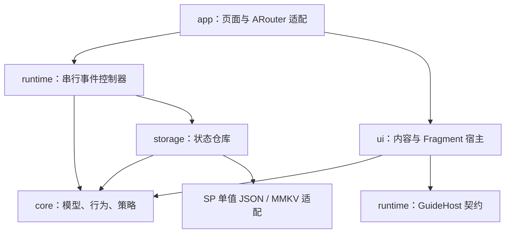
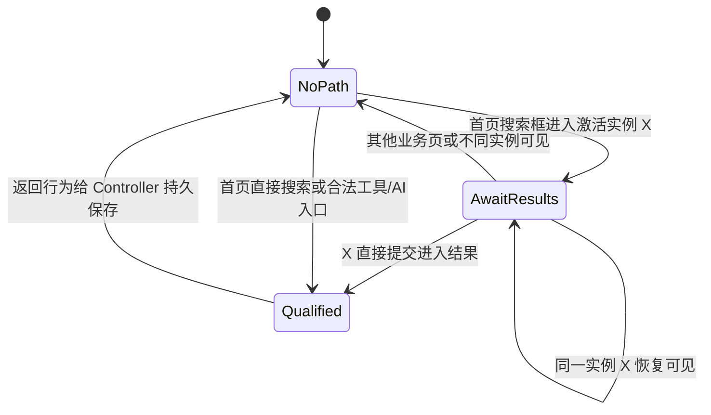
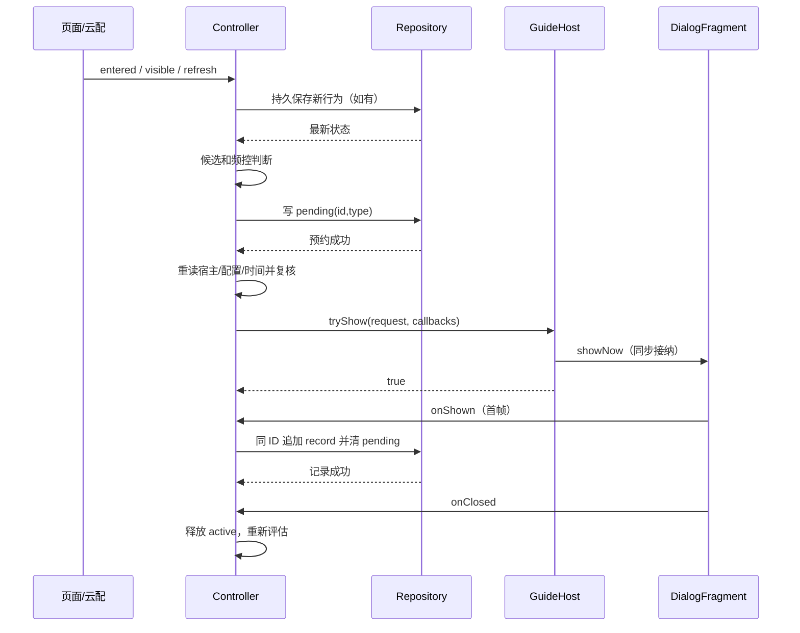

# 小组件添加引导系统设计

本文对应 Demo4 当前实现，面向接手维护和迁移到正式浏览器项目的开发者。代码使用 Kotlin + XML，默认存储为 SharedPreferences，提供 MMKV 替换边界。这里的 Navigation 指本模块的导航事件协议及 `DemoNavigation` 适配器，不是 Jetpack Navigation 组件。

## 1. 目标、范围与核心约定

系统根据用户已经完成的行为，在合适的页面展示两种小组件添加引导，并控制打扰次数。

| 名称 | 代码枚举 | 含义 |
|---|---|---|
| A | `GuideType.TOOLS` | 工具组件添加引导 |
| B | `GuideType.AI_NEWS` | AI 资讯组件添加引导 |

实现范围包括行为识别、资格持久化、云配控制、位置匹配、频控、弹窗展示、已有添加入口跳转以及可运行的验证宿主。已有桌面/负一屏小组件本体、真实截图、生产云配服务和厂商添加能力不在本仓库内。

核心约定：

1. **完成行为与当前允许弹窗是两件事。** 行为一旦完成，持久保留；暂时关闭云配、当天已弹、冷却未到、页面不对都不清除行为。
2. **未完成路径只存在内存中。** 从首页进入搜索激活页，还不算完成；到结果页前绕经其他业务页，链路失效。进程重启不恢复半条链路。
3. **展示以内容首帧绘制回调为口径。** 准备展示、排队、调用路由、调用 `showNow` 都不等于计次。
4. **A/B 共用每日一次、累计三次限制，各自计算冷却。** 首页和我的展示的 A 使用同一份 A 历史。
5. **不识别是否已经添加。** 点击添加或打开落地页不设置 `everAdded`，也不因此停止自动引导。
6. **无法确认状态时暂停自动引导。** 不把损坏数据当空数据，也不把预约当作已经展示。
7. **手动入口始终独立。** 设置页直接进入添加能力，不读取自动资格、不增加自动引导次数。

## 2. 业务规则矩阵

### 2.1 行为和展示位置

| 已完成行为 | 合法路径 | 持久字段 | 可以支持的展示 |
|---|---|---|---|
| 首页搜索 | 首页搜索框 → 搜索激活 → 搜索结果 | `HOME_SEARCH` | 首页各频道的 A |
| 首页直接搜索 | 首页搜索按钮 → 搜索结果 | 同一个 `HOME_SEARCH` | 首页各频道的 A |
| 我的工具访问 | 我的 → 书签 / 历史 / 下载 | `MINE_TOOL` | 我的页的 A |
| AI 资讯访问 | 首页 AI 快看 → 资讯详情 | `HOME_AI_DETAIL` | 首页 AI 快看频道的 B |

`HOME_SEARCH` 不支持在我的页弹 A，`MINE_TOOL` 不支持在首页弹 A。两个行为独立，只有 A 的历史共用。

完成首页搜索后，可以继续去其他页面任意多次，再回到首页等待展示。只有**结果页出现前**的绕行才使未完成搜索链路失效。

### 2.2 候选顺序

| 实际可见位置 | 候选顺序 | 说明 |
|---|---|---|
| 首页 AI 快看 | B → A | B 的任一条件不满足时继续判断 A |
| 首页推荐 / 体育 / 地区 | A | 不允许 B |
| 我的 | A | 使用 `MINE_TOOL` 资格 |
| 其他业务页 / 无宿主 | 无 | 不产生自动弹窗 |

当前实现将 A 的首页范围定义为全部频道。`GuidePolicy(toolsOnAllHomeChannels = false)` 只从 AI 频道移除 A，**并不把 A 限制到推荐频道**。若产品需要“仅推荐”，必须增加更细的 Surface 或修改映射，不能误用这个开关。

### 2.3 频控公式

设某类型已有的记录为 `own`，最后展示时间为 `last`：

- `own.size == 0`：该类型第一次无冷却。
- `own.size == 1`：`next = last + firstPopInterval × 86,400,000ms`。
- `own.size >= 2`：`next = last + secondPopInterval × 86,400,000ms`。
- A/B 所有记录里只要有一条 `localEpochDay == 今天`，当天拒绝。
- A/B 全部 `records.size >= 3`，永久停止自动引导，直到用户清除应用数据等明确重置。

默认间隔为 1 / 3，即同类型第一次之后至少 24h，第二次之后至少 72h。间隔允许零，但不能绕过每日一次。

例如上海时间 10 日 23:00 展示 A，11 日 01:00 虽已跨自然日，但 A 的 24h 未满；从未展示过的 B 如果满足行为且处在 AI 频道，可以在此时展示。B 展示后又会占用 11 日的全局日额度。

## 3. 模块划分和依赖方向



| 层 | 主要文件 | 职责 | 不负责 |
|---|---|---|---|
| core | `GuideModels` | 状态、配置、时间、决策数据模型 | Android 生命周期 |
| core | `GuideBehaviorTracker` | 验证来源、入口和路径，返回完成行为 | 写盘、是否能展示 |
| core | `GuidePolicy` | 候选优先级和纯频控判断 | 启动协程、创建窗口 |
| storage | `PersistentGuideRepository` | 单实例 Mutex + IO 读改写 | 业务页面判断 |
| storage | `GuideStateCodec` | 版本化 JSON 和严格解码 | 自动修复/清空损坏状态 |
| runtime | `WidgetGuideController` | 串行事件、预约、复核、计次、到期刷新 | ARouter 和具体 XML |
| runtime | `GuideConfigSource/Parser` | 配置流契约、JSON 校验 | 网络请求和云缓存策略 |
| ui | `FragmentGuideHost` | 生命周期/管理器检查、同步接纳、精确取消 | 业务资格判定 |
| ui | `WidgetGuideDialogFragment` | XML 渲染、首帧/关闭通知、防连点 | 直接修改频控 |
| app | `GuideApplication` | 进程级依赖组装 | 正式服务接入 |
| app | `MainActivity/DetailActivity` | 可见位置和导航事实接入 | 重复实现频控规则 |
| app | `DebugActivity` | 验证配置、时钟、显式重置 | 正式产品功能 |

核心模块不依赖 ARouter。迁移时先替换接入层，尽量保持行为、策略和存储协议不变。

## 4. Navigation 字段逐项说明

### 4.1 `PageRef`：一个逻辑页面实例

```kotlin
data class PageRef(val id: String, val kind: PageKind)
```

| 字段 | 表示什么 | 例子 | 约束 |
|---|---|---|---|
| `id` | 具体页面实例的身份 | `root-1:home:0`、`search-active-17` | 同一页恢复保持不变；不同实例不能复用 |
| `kind` | 业务页面类型 | `HOME_OTHER`、`SEARCH_ACTIVE` | 相同类型允许有多个不同实例 |

`PageRef` 是 data class，比较时 **id 和 kind 都要相同**。用类名 `SearchActivity` 当 ID 无法区分两个激活页，会导致借用错误来源。

主页面只有一个 Activity，但首页推荐、首页 AI、我的仍是不同逻辑页。验证宿主用 `rootId + :home:频道下标` 或 `rootId + :mine` 生成身份。配置重建恢复 `rootId`、底部位置和频道；业务跟踪器不依赖 Activity 类名判断位置。

### 4.2 `NavigationEvent`：一次成功进入事件

```kotlin
data class NavigationEvent(
    val id: String,
    val from: PageRef,
    val to: PageRef,
    val entry: EntryPoint
)
```

| 字段 | 含义 | 谁提供 | 作用 |
|---|---|---|---|
| `id` | 本次导航动作的唯一 ID | 发起路由时生成，随路由参数传递 | 同一事件重复上报去重 |
| `from` | 跳转前真实可见的页面实例 | 来源页面适配层 | 必须匹配跟踪器当前页，排除伪造/过期来源 |
| `to` | 本次已经进入的目标实例 | 发起方生成身份，目标页接收 | 成为新的当前页；后续导航将它作为来源 |
| `entry` | 用户通过哪个入口跳转 | 可信内部点击/路由适配层 | 区分首页搜索、我的工具、AI 资讯和普通跳转 |

**事件 ID 与页面 ID 不同。** 例如 `navigationId=n1` 把 `home-1` 带到 `active-1`；下一次 `navigationId=n2` 把 `active-1` 带到 `result-1`。第二次的 `from.id` 复用上一页 `to.id`，但事件 ID 必须更新。

同一次事件重传保留原 `id`。返回已有页面调用 `visible`，不要创建新的 `NavigationEvent`。同一 Intent 因旋转重建也不应被当作新导航。

### 4.3 `PageKind` 全部值

| 枚举 | 业务含义 |
|---|---|
| `HOME_OTHER` | 首页非 AI 频道，包括推荐、体育、地区 |
| `HOME_AI` | 首页 AI 快看频道 |
| `MINE` | 我的页 |
| `SEARCH_ACTIVE` | 搜索激活页，尚未到结果 |
| `SEARCH_RESULTS` | 搜索结果页 |
| `BOOKMARKS` / `HISTORY` / `DOWNLOADS` | 书签 / 历史 / 下载页 |
| `NEWS_DETAIL` | 资讯详情，需结合来源才能区分是否 AI 行为 |
| `OTHER` | 其他所有业务页，包括设置、添加页、调试页 |

### 4.4 `EntryPoint` 全部值

| 枚举 | 有效来源和目标 | 行为结果 |
|---|---|---|
| `HOME_SEARCH_BOX` | 首页 → 搜索激活 | 暂存该激活页实例，还不完成行为 |
| `HOME_SEARCH_BUTTON` | 首页 → 搜索结果 | 完成 `HOME_SEARCH` |
| `SEARCH_SUBMIT` | 被暂存的同一激活实例 → 搜索结果 | 完成 `HOME_SEARCH` |
| `MINE_TOOL` | 我的 → 书签/历史/下载 | 完成 `MINE_TOOL` |
| `AI_ARTICLE` | 首页 AI 频道 → 资讯详情 | 完成 `HOME_AI_DETAIL` |
| `OTHER` | 普通导航 | 不产生特殊资格，正常更新当前页并中断旧的未完成链路 |

不能仅凭 `to.kind == SEARCH_RESULTS` 就授予搜索资格，也不能在任何搜索页随意填 `HOME_SEARCH_BUTTON`。这些字段是内部事件协议，不是可信的外部 deeplink 参数。

### 4.5 `DemoNavigation.page()` 与 Intent 参数

方法入参 `context` 为路由上下文，`from` 为当前真实页，`to` 为目标类型，`entry` 默认为 `OTHER`。它向 `/browser/page` 传递：

| Intent key | 来源 | 消费位置 |
|---|---|---|
| `pageId` | 新 UUID | 目标 `PageRef.id` |
| `pageKind` | `to.name` | 目标 `PageRef.kind` |
| `fromId` | `from.id` | 来源 `PageRef.id` |
| `fromKind` | `from.kind.name` | 来源 `PageRef.kind` |
| `entry` | `entry.name` | `NavigationEvent.entry` |
| `navigationId` | 另一个新 UUID | `NavigationEvent.id` |

`DetailActivity` 在首次 `onCreate` 解析合法内部参数并上报 `entered`，在 `onResume` 上报 `visible`。这是验证工程对“目标已进入”的接入点：意味着目标业务 Activity 已创建，不代表目标页首帧已显示。正式项目如果有登录拦截、重定向、路由中转或内容校验，须在真正到达业务目标后上报，不能照搬中转页的 `onCreate`。

当前目标 Activity 是 standard。正式页面复用 singleTop/singleTask 时，在 `onNewIntent` 中识别新的导航事件并更新 page 身份；普通恢复只上报 `visible`，不要每次 `onResume` 重新生成事件 ID。

### 4.6 完整路径示例

```kotlin
val home = PageRef("root-1:home:0", PageKind.HOME_OTHER)
val active = PageRef("active-1", PageKind.SEARCH_ACTIVE)
val results = PageRef("results-1", PageKind.SEARCH_RESULTS)

// 真实首页已可见。
controller.visible(home)

// 目标激活页已进入。先 entered，再 visible。
controller.entered(NavigationEvent("nav-1", home, active, EntryPoint.HOME_SEARCH_BOX))
controller.visible(active)

// 从同一个激活页直接提交并进入结果页，才完成首页搜索行为。
controller.entered(NavigationEvent("nav-2", active, results, EntryPoint.SEARCH_SUBMIT))
controller.visible(results)

// 行为已经持久完成，后续多次导航不撤销资格。
controller.visible(PageRef("other-1", PageKind.OTHER))
controller.visible(home)
// 返回时还要让宿主快照真正可展示，并 refresh；visible 本身不是展示许可。
```

`visible` 与 `HostSnapshot` 不能相互替代：前者服务于路径识别，后者服务于弹窗位置与可展示性判断。两者要来自同一真实页面状态。

## 5. 行为跟踪器状态机

跟踪器保存 `current`（当前页）、`searchActivation`（被首页授权的激活实例）和最近 32 个事件 ID。已完成资格不保存在这里。



处理 `entered` 的顺序：

1. 若事件 ID 在最近 32 个中，直接忽略。
2. 保存 `current == from` 的校验结果，暂存旧 `searchActivation`。
3. 清除旧链路，更新 `current = to`。即使来源不匹配，也不继续保留过期链路。
4. 来源不匹配则不授予行为。
5. 来源匹配时，按来源类型、入口、目标类型识别。
6. Controller 将返回行为加到 `GuideState.behaviors`；如果已经存在，不重复写盘。

最近 32 个 ID 只是短期内存去重，不是任意历史事件重放保护；正式接入层仍须保证事件 ID 与生命周期上报正确。达到三次上限时 `tracker.clear()`，Controller 不再调用行为识别。云配关闭不属于停止行为采集条件；异常暂停 `fault` 则会暂停采集。

## 6. 领域状态和持久协议

### 6.1 持久字段

| 模型/字段 | 含义 | 写入时机 |
|---|---|---|
| `GuideState.behaviors` | 已完成的行为集合 | 新行为第一次满足 |
| `GuideState.records` | A/B 已展示历史 | 首帧回调后的写盘 |
| `GuideState.pending` | 尚未完成记账的展示预约 | 请求宿主之前 |
| `PendingShow.id/type` | 本次展示尝试 ID 与类型 | 资格允许后生成 |
| `ShowRecord.id/type` | 同一展示尝试的 ID 与类型 | 由 pending 转成记录 |
| `shownAtMillis` | 首帧回调时刻 | 在回调处捕获，避免事件队列延迟改变时间 |
| `localEpochDay` | 首帧时本地日期的整数表示 | 与毫秒时间使用同一 GuideTime |

SP 文件为 `browser_widget_guide.xml`，key 为 `state_v1`。以下是协议结构示意；示例时间是 epoch 起点，不代表真实业务时间：

```json
{
  "version": 1,
  "behaviors": ["HOME_SEARCH"],
  "records": [
    {"id": "presentation-1", "type": "TOOLS", "shownAt": 0, "day": 0}
  ],
  "pending": null
}
```

`shownAt` 对应 `shownAtMillis`，`day` 对应 `localEpochDay`。没有独立的 count 字段，次数从 `records.size` 派生，避免次数与记录分开写产生不一致。

### 6.2 仓库读改写

`PersistentGuideRepository` 在一个 Mutex 内执行“读取最新 JSON → 严格解码 → transform → 编码 → 写入”。磁盘与编解码在 IO dispatcher 执行。`transform` 必须是纯转换，不可操作 UI 或递归调用仓库。

SharedPreferences 使用同步 `commit()` 并检查 Boolean，不能改成 `apply()` 后无条件认为成功。即使重试的新值与读回值相同，也再次写盘，因为失败的 commit 可能已经改变 SP 的内存视图。

Mutex 只覆盖**这个实例**。同文件不可由多个 Repository 实例或多个进程分别读改写。其他进程事件必须转发到主进程唯一 Controller。

### 6.3 严格解码与版本升级

解码要求版本等于 1、存在 pending 字段、枚举合法、记录 ID 非空且唯一、时间非负、日期在接受范围内，且 pending ID 不与已展示记录重复。额外未知字段没有显式拒绝，但未知 schema 版本会失败。

损坏 JSON 或未知版本抛异常，Controller 暂停；不会自动变成 `GuideState()`。未来升级协议，应增加显式迁移分支及迁移测试，保留行为和历史，不得仅修改版本号后把旧值当空数据。

### 6.4 MMKV 替换方式

保留 `GuideStateCodec` 与 `PersistentGuideRepository`，只替换 `StringStateStore.read/write`。读写仍是一个 JSON key，按项目已经使用的 MMKV 版本实现写入/同步契约；返回失败或传播异常，不能无条件返回 true。本仓库未引入 MMKV 依赖，也未验证某个 MMKV 版本的落盘保证。

频控文件须排除云备份和设备迁移。本验证 app 还关闭整体备份；正式项目可保留自身备份策略，只排除此文件。应用升级通常保留状态；清除数据/卸载重装按需求重新开始。

## 7. 展示协调、线程和并发

### 7.1 主线程边界

Application 创建进程唯一 Controller。`attach/detach/visible/entered/refresh/close` 以及 Host 回调均要求从主线程调用。代码没有强制的线程断言，接入方必须遵守。

Controller 用 `Channel.UNLIMITED` 接收事件，一个消费者顺序处理。无界队列避免丢失首帧等关键事实，但要求入口只上报业务变化，禁止在每次 RecyclerView bind、布局或动画帧调用 refresh。生产若需要去抖，只能合并可替代的刷新，不能丢弃 entered/shown/closed。

Repository 挂起不阻塞主线程。期间宿主位置、引用、配置都可能变化，因此“一个事件消费者”并不等于可以省略展示前二次校验。

### 7.2 HostSnapshot

| 字段 | 说明 |
|---|---|
| `hostId` | 逻辑宿主 ID，用于区分逻辑宿主身份 |
| `version` | 位置/有效性变化递增，发现离开后又回到原位置的情况 |
| `surface` | 实际可见的底部 Tab 与首页频道组合 |
| `canPresent` | 当前恢复前台、Fragment 状态未保存等可展示条件 |

Controller 同时比较宿主对象引用和整个快照。`version` 不能在 getter 内递增；本引导自身出现也不能让 `canPresent=false`，否则自己会触发自己取消。

### 7.3 一次展示的完整时序



- 复核失败：清除预约，再排队刷新，不请求窗口。
- `tryShow=false`：必须确认没创建窗口、没排队；可清预约，等待管理器可用通知。
- `tryShow` 抛异常：无法证明窗口没出现，保留预约并暂停。
- 已接纳但首帧前条件失效：请求原宿主 cancel，最终由 onClosed 释放未显示预约。
- 已经首帧显示：次数事实保留。离开页面/关闭配置可取消窗口，但不会减次数。

“预绘制通知”是可观测的本地计数点，不能证明用户真的看见、阅读了内容，也不能和存储组成硬件层面的原子事务。

### 7.4 运行中字段

| 字段 | 用途 |
|---|---|
| `host` | 最新连接宿主，attach/detach 立即更新 |
| `state` | 最近一次成功仓库读写返回的状态 |
| `active` | 当前正在接纳/展示的请求，同一时刻最多一个 |
| `activeHost/activeSnapshot` | 该请求属于哪个宿主、基于哪份位置快照 |
| `shown` | 当前请求是否已收到首帧，防止写盘失败后错误释放预约 |
| `retryRecord` | 首帧已发生、待成功提交的原始记录 |
| `fault` | 异常暂停标志，阻止新自动展示及行为采集 |
| `timer` | 唯一下一次到期刷新任务 |
| `status` | 开发诊断流，不是额外的业务决策状态源 |

### 7.5 计次幂等

Controller 先核对回调 ID 是否属于 active，再用 shown 去重。仓库提交时再次核对 record ID；同 ID 已存在则不重复追加。重复首帧回调、重复 refresh 和失败后的同 ID 重试都不能增加第二条记录。

计数后关闭不会清除行为。点击添加只进行路由；不另加次数、不取消已有次数。

## 8. 崩溃恢复和异常矩阵

窗口展示和磁盘写入不能形成一个事务。系统选择宁可少弹，也不在无法确认时重复打扰。

| 场景 | 磁盘/内存结果 | 后续处理 |
|---|---|---|
| 保存行为失败 | 不确认新行为成功 | fault，暂停自动流程；不自动清空历史 |
| 写预约失败 | 不能确认持久化结果 | fault；不继续请求新窗口 |
| 预约写成功，复核不通过 | 清除预约 | 等待新的有效位置/配置 |
| 管理器明确拒绝 | 清除预约，不新增记录 | 名额恢复调用 refresh |
| 接纳后未首帧就关闭 | 清除预约，不新增记录 | 资格仍保留，后续可再评估 |
| 首帧成功且记录写成功 | records +1，pending=null | 继续遵守每日和累计限制 |
| 首帧成功但记录写失败 | retryRecord 保留原 ID/时间；fault | 后续 refresh 重试同一记录，成功后解除 fault |
| 写预约后到完成记账前进程死亡 | 磁盘可能只剩 pending | 重启暂停，不把 pending 算次数，也不直接再弹 |
| JSON 损坏/未知版本 | 读取失败 | 暂停，报告错误，禁止静默重置 |
| 宿主 tryShow 抛异常 | 可能已经出现窗口 | 保留预约，暂停，不按 false 处理 |
| Fragment 被系统恢复但无 callbacks | 没有活跃展示所有者 | 在窗口创建前禁用并移除旧 Fragment |

通用 `fault` 没有自动重试所有错误。只有已有 `retryRecord` 的首帧记账失败，在 Refresh 时有明确重试路径。启动残留 pending、损坏数据、预约写失败等，不会因为普通 refresh 自动清零恢复。正式版本没有“自动清空并重新计数”的入口，运营若要引入恢复策略需单独设计和验收。

`fail()` 当前主要暂停新展示和计时器，不是一个保证关闭所有可能窗口的通用清理事务；宿主必须遵守接受/拒绝/取消契约，异常应尽量在尚未创建窗口前检查。`close()` 会请求取消 active，但不承诺进程结束时完成异步持久记账；残留情况仍由 pending 策略兜底。

## 9. 时间、配置和重新评估

### 9.1 时间策略

冷却使用系统毫秒时间，日额度使用展示时本地日期。`nextMidnightMillis` 按时区计算下一日期起点，不能简单加 24h；夏令时切换日可能是 23h 或 25h。

若历史记录的毫秒或日期晚于当前快照，返回 `CLOCK_ROLLBACK`，不删除记录。时区大幅变化也可能触发保守阻断。此实现没有可信服务端时间，不提供本地时间篡改防护。

每次 evaluate 取消旧 timer。若没有可展示候选，从 DAILY/COOLDOWN 的重试时间中选择最早值启动协程 delay。调度只是“到时再判断”，不是到点必弹；仍需有效宿主和配置。没有 Alarm/WorkManager，不在进程死后拉起 App 展示。

时间/时区变化时，正式宿主应 refresh；回前台也 refresh。本验证宿主在恢复页面和推进调试时间时刷新，没有另外注册系统时间变化广播。

### 9.2 云配格式

```json
{
  "browserWidgetGuideRules": {
    "enablePop": true,
    "firstPopInterval": 1,
    "secondPopInterval": 3
  }
}
```

`enablePop` 必须是真 Boolean；开启时两个间隔须为非负 Int。缺失、错误类型、负数、溢出或非法 JSON 返回默认关闭。关闭时允许省略间隔字段。A/B 共用配置值，但各自根据记录计算到期时间。

正式适配器发布 `StateFlow<GuideConfig>`；拉取、缓存、过期、失败时是否沿用最后有效配置由项目现有云配体系决定。配置更新不得重置 GuideState。

验证 `DemoConfigSource` 仅存内存，冷启动默认关闭；Release 没有生产云配接入，因此默认不会自动弹。

## 10. UI 和已有添加能力

`GuideContent` 的 title/description 是文案，previewRes/previewDescription 是图片及无障碍说明，desktopDeeplink/assistantDeeplink 是两个添加入口。两类引导共用 XML 布局，控制器无需知道资源和路由地址。

`FragmentGuideHost.tryShow` 除快照外还检查：Activity RESUMED、未 finishing/destroyed、FragmentManager 未保存状态、统一管理器有名额、固定 tag 未被占用。通过后 showNow，同步返回接受结果；计数在 Dialog 的 OnDraw 回调中完成。

`WidgetGuideDialogFragment` 的 reported、closed 分别限制首帧和关闭回调一次；navigating 防止连点。路由成功发起后关闭，失败或抛异常则提示且允许重试。已首帧发生就不撤销次数。

验证链接：

| 地址/参数 | 用途 |
|---|---|
| `demo4://guide/widget/add?type=tools&target=desktop` | A 的桌面添加验证 |
| `demo4://guide/widget/add?type=tools&target=assistant` | A 的负一屏添加验证 |
| `type=ai` | B 的同类入口 |
| `demo4://guide/widget/add` | 设置页手动选择入口，缺省 choose |

适配器仅接受 scheme=demo4、host=guide、path=/widget/add。当前返回 true 表示 ARouter 调用已发起，没有等待目标页显示或真实添加完成；正式路由需要结合自身错误/异步回调定义返回语义。`WidgetAddActivity` 只是参数回显页。

## 11. 正式项目接入步骤

1. 引入 `widget-guide`，在主进程依赖容器创建唯一 Store、Repository、ConfigSource、Controller。
2. 将正式云配转为已校验的 StateFlow，默认关闭；注入系统时钟，不迁移调试时钟。
3. 适配页面事件。首页、我的、首页频道、搜索、工具、资讯以及中间页面都要报告真实身份。失败转场不上报 entered；返回只报 visible。
4. 适配主页面快照。底部 Tab、顶部频道、前后台、页面遮挡和 Fragment 可提交状态变化时更新 version 并 refresh。
5. 将统一弹窗管理器接到 GuideHost。忙时同步拒绝，空闲时 refresh；不能在 tryShow 中另排一个保留过期资格的队列。
6. 注入真实截图/文案/桌面及负一屏链接；设置页直接走相同 navigator，不经过自动引导。
7. 给 SP 文件增加备份排除。已有 MMKV 项目仅替换 StringStateStore，维持单进程单实例。
8. 将 reportError 接到监控；按验收清单联调路由复用、弹窗竞争、旋转、杀进程和时间变化。

如果现有管理器必须排队，应先排“展示权申请”，取得名额后 refresh，再由 Controller 重新判断。不要提前捕获 Allow 并保存一个稍后执行的 show 闭包。

对于 Activity 单例引用，MainActivity 在 onDestroy 调用 detach；已接纳窗口结束后 Controller 也清理 activeHost。自定义 Host 必须完成 onClosed，否则 active 可能一直阻塞新请求并保留旧宿主。

## 12. 诊断、测试与维护

### 12.1 拒绝原因

| 原因 | 首先检查 |
|---|---|
| `DISABLED` | 当前配置源是否真的开启；验证配置重启会丢失 |
| `LIMIT` | A/B 总记录是否达到三条 |
| `RECOVERY_REQUIRED` | 是否存在无法确认的 pending |
| `HOST` | surface、canPresent、宿主引用、Fragment 生命周期 |
| `BEHAVIOR` | 当前位置要求的行为是否满足；from/entry 是否正确 |
| `DAILY` | 今天 A/B 是否已展示任一类型 |
| `COOLDOWN` | 当前类型自己的最后时间及间隔配置 |
| `CLOCK_ROLLBACK` | 虚拟时间/系统时间/时区是否早于持久记录 |

策略按固定顺序返回第一个原因，所以 `DISABLED` 可能遮盖同时存在的其他阻断。Controller 启动残留 pending 会直接进入 fault，状态文字可能显示 Recovery required，而不再经过策略返回原因。管理器拒绝则显示 Waiting for dialog manager。

status.message 供调试阅读，不建议生产逻辑解析英文字符串。监控可在接入层记录拒绝枚举、presentationId、宿主版本、首帧提交失败和残留预约，不记录搜索词、书签内容或资讯正文。本仓库只有 status 与错误日志，未实现服务端埋点。

### 12.2 自动化测试布局

| 文件 | 用例数 | 覆盖重点 |
|---|---:|---|
| `GuideBehaviorTrackerTest` | 11 | 合法路径、绕行、实例匹配、恢复、去重 |
| `GuidePolicyTest` | 18 | 行为隔离、位置、A/B 优先级、日额度、冷却、回拨、夏令时 |
| `WidgetGuideControllerTest` | 11 | IO 竞态、首帧去重、拒绝、配置更新、残留预约、同 ID 重试 |
| `PersistenceTest` | 6 | 真实 SP 重建、协议、损坏状态、失败写入、云配解析 |
| `FragmentGuideHostTest` | 3 | 管理器拒绝、首帧时机、重复 tag、无所有者恢复 |

总计 49 个测试。每个用例现在都有中文业务说明，英文函数名保持不变。测试替换时钟和调度器，IO 竞态用 CompletableDeferred 人为停在预约写入处，验证挂起期间切页面/关配置不会产生旧窗口。

```bash
./gradlew :widget-guide:testDebugUnitTest :app:assembleDebug :app:assembleRelease :app:lintDebug :widget-guide:lintDebug
```

Windows 使用 `gradlew.bat`。CI 在 push/PR 执行上述任务，并保存报告和 Debug APK。Release 为混淆构建，发布签名由正式项目提供。Robolectric 不能替代真实厂商桌面/负一屏和真实设备上的窗口可见性联调。

### 12.3 验证宿主的使用

首次默认推荐频道且云配关闭。进入开发面板启用开关，按首页搜索路径进入结果，再经过任意页面返回首页，观察 A。当天完成 AI 行为后 B 被日额度拦截；前进测试时钟 24h，再回 AI 频道无需新行为即可评估 B。

调试时间不持久化，但展示时间持久化；使用未来测试时间后直接重启，会出现记录在未来的回拨阻断。独立测试组之间显式清空状态，避免误诊。Debug 包名带 `.debug`，与 Release 数据隔离。

### 12.4 修改规则时的检查点

| 要改的内容 | 主要位置 | 必须一起检查 |
|---|---|---|
| 新行为或合法路径 | Behavior、PageKind、EntryPoint、Tracker | Codec 枚举兼容、页面事件接入、路径测试 |
| 展示频道范围/优先级 | Surface 映射、GuidePolicy.candidates | HostSnapshot 与候选测试 |
| 冷却/次数 | GuidePolicy、GuideState.exhausted | 定时刷新、现有记录兼容、边界测试 |
| 存储后端 | StringStateStore 实现 | 写入失败契约、备份排除、单实例约束 |
| 首帧计数口径 | Dialog/Host 回调契约 | 幂等、未绘制关闭、崩溃窗口、UI 测试 |
| 恢复策略 | Controller 初始化及 fault 分支 | 不伪造次数、不静默丢历史、迁移方案 |
| 正式路由 | app 的导航适配层 | 来源可信、复用 Intent、失败转场、重复上报 |

## 13. 推荐阅读顺序和关联文档

先读本文第 2、4 节明确规则与 Navigation，再读 `GuideModels.kt`、`GuideBehaviorTracker.kt`、`GuidePolicy.kt`。随后读 `WidgetGuideController.kt` 理解状态变化，再看 storage 与 ui。最后用 app 的接入及 49 个测试验证理解。

- [README：运行入口与功能范围](../README.md)
- [INTEGRATION：正式项目接入契约](INTEGRATION.md)
- [ACCEPTANCE：设备操作与验收清单](ACCEPTANCE.md)

仓库自写 Kotlin、测试、XML 和构建配置均有中文说明；官方 Gradle Wrapper 启动脚本及二进制保持原样，避免修改第三方生成代码。
