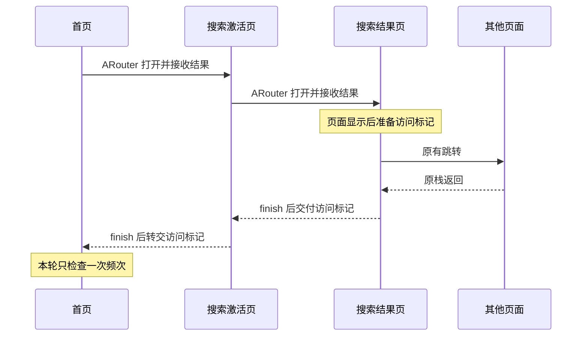

# B 分支：桌面组件引导系统设计与实现方案

更新日期：2026-10-11。技术栈：Kotlin + XML，现有 ARouter，本地 SP 或 MMKV。

**按普通页面栈返回设计：打开页面使用 ARouter；返回使用系统返回键、返回手势或页面的 `finish()`。返回时不重新启动首页。**

原先方案废弃。本文是 B 分支代码依据，配套 [接入说明](INTEGRATION.md) 和 [单测、验收与风险](ACCEPTANCE.md)。仓库已按此方案替换旧的页面事件与持久资格逻辑。

## 1. 先用一条搜索流程说明

首页打开搜索激活页，搜索激活页打开搜索结果页。搜索结果页真正显示过后，准备一个“访问过搜索结果”的返回字段。之后用户可以继续打开任何页面，这些页面都保持原样。

用户逐层返回时，搜索结果页结束，搜索激活页收到该字段；搜索激活页再结束，首页收到该字段。首页只在这次返回时检查弹窗频次，允许就弹 A，不允许就结束。

首页只打开搜索激活页又返回，或者只去过游戏 / 视频页，没有“访问过搜索结果”的返回字段，因此不弹。需要改的是入口、激活页和结果页，不是所有经过的页面。



`setResult()` 只是准备返回数据，不关闭当前页；`finish()` 或系统返回结束当前页时，数据才交给启动它的页面。由 Android 负责调用关系，我们不另建页面栈。

## 2. 页面与入口要求

| 页面 | UI 与点击行为 |
|---|---|
| 首页推荐 tab | 顶部搜索框、搜索按钮、扫一扫。普通点击搜索框进入激活页；搜索按钮进入结果页；高亮暗词由 deeplink 决定实际落点 |
| 搜索激活页 | 顶部搜索框与按钮；下面依次是搜索历史、猜你想搜、热搜榜。横向 ViewPager 包含游戏、电影电视、综艺、视频榜 |
| 榜单条目 | 电影电视与综艺条目进入结果页；游戏、视频条目的普通落点不是结果页 |
| 搜索结果页 | 展示搜索结果；进入此页面是搜索路径的关键条件，不要求再点击某条结果 |
| 首页 AI 快看 tab | AI 资讯列表，点击资讯进入详情 |
| 我的页 | 书签、历史、下载、设置入口；书签和历史在同一 Activity 的左右两个 tab |
| AI 搜页面 | AI 快看入口打开二级列表，二级列表打开资讯详情 |
| 设置页 | 新增“添加桌面组件”；仅荣耀设备显示，点击 deeplink 到快服务添加界面 |

本文的 Activity 名和路由地址是接入示意，不要求正式项目按这些名字新建页面。已有 Fragment tab 继续复用，结果由承载它的 Activity 接收并分发。

## 3. 触发与展示位置

| 原入口 | 必须访问的关键页 | 返回到哪里才检查 | 弹窗与位置 |
|---|---|---|---|
| 首页搜索按钮 / 高亮暗词实际进入结果页 | 搜索结果页 | 原首页 | A，首页非 AI 快看 tab 底部 |
| 首页搜索框 → 搜索激活页 | 激活页打开的搜索结果页 | 原首页；激活页负责转交结果 | A，首页非 AI 快看 tab 底部 |
| 我的 → 书签 / 历史 | 书签历史容器 Activity | 原我的页 | A，我的页底部 |
| 我的 → 下载 | 下载页 | 原我的页 | A，我的页底部 |
| 首页扫一扫 | 扫一扫页 | 原首页 | A，首页非 AI 快看 tab 底部 |
| 首页 AI 快看列表 | 资讯详情页 | 原首页 AI 快看 tab | B，该 tab 底部 |
| AI 搜 → AI 快看二级列表 | 二级列表打开的资讯详情页 | 原 AI 快看二级列表 | B，二级列表底部 |

每一行允许关键页继续打开其他任意页面，再按原页面栈返回。其他页面不接入引导逻辑。工具、资讯、扫描访问以关键页面实际显示为准；扫描不要求识别成功。

搜索激活页可多次搜索。同一次从首页出去、最后返回首页的过程，最多产生一次检查。书签和历史 tab 切换也只属于同一次工具访问。

下列情况不产生弹窗：

- 冷启动进入首页。
- 首页 → 搜索激活页 → 返回首页，没有到过结果页。
- 首页 → 激活页 → 游戏 / 视频 → 按栈返回，没有到过结果页。
- 首页推荐 tab 的高亮暗词实际打开普通资讯详情。它不算搜索结果，也不属于 AI 快看入口。
- AI 搜 → AI 快看二级页 → 直接返回 AI 搜，没有访问资讯。
- 普通切 tab、锁屏解锁、后台回前台，没有收到本轮有效返回结果。

B 的二级页路径在返回二级列表时检查，不能继续传给 AI 搜后再弹。A/B 不互相兜底：A 的返回不在 AI tab 上改弹 B，B 被限频也不会改弹 A。

## 4. 系统只分三个职责

| 职责 | 放在哪里 | 做什么 |
|---|---|---|
| 页面结果回传 | 相关入口及关键业务页 | 打开时使用 requestCode；关键页准备访问标记；返回入口后发起一次检查 |
| 引导管理器 `WidgetGuideManager` | 单进程共享一个实例 | 读取配置与本地记录，判断频次，记录展示和点击停止；内部用简单存储类读写 SP/MMKV |
| 底部 Dialog | 当前展示页面持有 | Kotlin + XML，绑定标题、截图、两个按钮，处理取消与添加 |

管理器不认识搜索激活页、下载页或其他页面，也不维护路由记录。业务页面已确定本次是 A 还是 B，管理器只接收类型和当前展示宿主。

建议的文件职责：

| 文件 | 内容 |
|---|---|
| `GuideResultContract.kt` | requestCode、访问标记，以及二者与弹窗类型的对应关系 |
| `WidgetGuideManager.kt` | 频次判断、展示入口、展示计数、添加点击停止 |
| `GuideStore.kt` | 小型 SP 实现；项目已有 MMKV 时替换读写即可 |
| `WidgetGuideManager.kt`、`dialog_widget_guide.xml` | 普通 Dialog 的展示与底部 XML |
| 相关页面现有 ViewModel | 本轮尚未返回的 requestCode；激活页另存本轮是否访问过结果 |

类型和小数据类可放在以上文件中，不需要为每个字段新建一层框架。

## 5. 返回协议为什么足够

### 5.1 打开与返回各自负责什么

相关入口使用 ARouter 的 `navigation(activity, requestCode)`。仍然走现有路由，额外让 Android 在目标页结束后交付结果。

关键页显示后，把 `guide_visit` 加入该页自己的返回 Intent。四种值代表搜索结果、工具、扫一扫、AI 资讯详情。它说明实际到过哪一种关键页，不说明添加成功。

原入口同时匹配“自己正在等待的 requestCode”和“期望的 guide_visit”。不同访问标记避免高亮暗词实际跳资讯却被误认作搜索。

仅搜索激活页需要中转：收到搜索结果标记后，将同样含义写入自己的返回数据；等激活页正常返回首页再交付。任意后续页面不复制此字段。

### 5.2 最少的内存状态

| 状态 | 生命周期 | 用途 |
|---|---|---|
| `waitingRequestCode` | 入口的普通 ViewModel | 等待当前业务返回；收到对应回调先清空，防止重复消费 |
| `hasVisitedSearchResults` | 激活页的普通 ViewModel | 本次激活页停留期间，已经收到过搜索结果访问标记 |
| `pendingReturn` | 入口 Activity 临时字段 | 回调早于页面恢复时，交给紧接着的恢复回调消费一次 |

不写 SP/MMKV，不写 SavedStateHandle，不保存为可跨进程恢复的资格。普通 ViewModel 保留旋转时的在途关系；进程结束后新实例没有等待关系，恢复出的历史结果不触发引导。

`pendingReturn` 只是这次返回结果与页面恢复之间的 UI 交接。入口恢复时先取出并清空，再检查当前 tab 和频次；所有拒绝直接结束。若交接期间再次离开页面或切换展示位置，也清空。冷却到期、跨天、云配刷新都不会重新唤起它。

### 5.3 保留原有业务返回

引导只追加字段，不能用新 Intent 覆盖原有扫码结果、选中条目等字段，也不能强行修改原业务 `resultCode`。

“扫描取消”和“扫描页面已访问”是不同事实。即使扫描业务返回 `RESULT_CANCELED`，只要带有效扫描访问标记且属于当前等待关系，仍可检查 A；没有标记的失败 / 取消不触发。

### 5.4 当前方案边界

普通页面栈返回按以上协议即可。不为全局清栈、重建任务栈、跨进程页面链建立追踪器。以后相关入口改变导航方式时，在该入口复核回传关系；不能把一次任意 Activity 回调当成完整栈路径证明。

## 6. 频次规则：A、B 各自最多三次

```json
{
  "browserWidgetGuideRules": {
    "enable": true,
    "firstPopInterval": 1,
    "secondPopInterval": 10,
    "thirdPopInterval": 30
  }
}
```

| 字段 | 用途 |
|---|---|
| `enable` | 自动弹窗总开关；关闭时本次返回直接结束 |
| `firstPopInterval` | 该类型第 1 次到第 2 次展示的最短间隔，天数乘固定 24 小时 |
| `secondPopInterval` | 该类型第 2 次到第 3 次展示的最短间隔，天数乘固定 24 小时 |
| `thirdPopInterval` | 不参与判断。是否存在、值是多少都不会产生第 4 次展示 |

| 某类型已展示次数 | 本轮频次条件 |
|---|---|
| 0 | 无首次冷却；本轮返回及其他限制通过即可弹 |
| 1 | 距该类型上次展示至少 `firstPopInterval × 24h` |
| 2 | 距该类型上次展示至少 `secondPopInterval × 24h` |
| ≥ 3 | 永不再弹该类型 |

A/B **合计本地自然日最多展示一次**。使用设备当前时区的日历日期；单类型冷却仍用固定 24 小时时长，两项分别判断。

展示时刻是冷却起点，不是取消、添加点击、发起搜索或访问详情的时刻。取消仍占用一次展示和当天共享额度。

例如 A 第一次在 10 月 11 日 10:00 展示，首次间隔 1 天。10 月 12 日 09:59 返回仍不弹；到 10:00 静留首页也不弹。之后重新完成搜索并返回才有新机会。若 B 当天已展示，A 即使冷却到期也不能展示。

工程异常处理：`enable` 缺失或结构解析失败时关闭自动引导。间隔可为 0，负数或无法安全换算的值无效；到需要该间隔的阶段才检查，缺失 / 无效则拒绝该次展示。配置更新自身不触发检查。

## 7. 本地只保存频次和停止状态

使用独立 SP 文件，例如 `browser_widget_guide_b`；MMKV 使用等价独立 ID。B 原型不读取废弃方案的行为字段。此仓库是方案 Demo；未来接入已上线应用，历史次数迁移须按线上记录决定，不能借换 key 清零已生效的限制。

| 键 | 类型 / 初始值 | 含义 |
|---|---|---|
| `common_tools_widget_show_count` | Int / 0 | 常用工具已展示次数 |
| `common_tools_widget_last_shown_at_millis` | Long / 0 | 常用工具上次展示毫秒时间 |
| `common_tools_widget_stopped_after_add_click` | Boolean / false | 是否点过常用工具的添加按钮 |
| `ai_quick_news_widget_show_count` | Int / 0 | AI 快看已展示次数 |
| `ai_quick_news_widget_last_shown_at_millis` | Long / 0 | AI 快看上次展示毫秒时间 |
| `ai_quick_news_widget_stopped_after_add_click` | Boolean / false | 是否点过 AI 快看的添加按钮 |
| `last_any_widget_guide_shown_at_millis` | Long / 0 | 两类最近一次展示时间，用于共享自然日额度 |

不存页面列表、来源页面 ID、搜索资格、资讯资格、待弹任务或冷却计时器。退出登录、配置变化、设置入口点击不重置记录。清除应用全部数据后，记录消失，按初始状态重新计算。

一次展示更新该类型次数、该类型时间和共享时间。SP 使用同一次 Editor 写入；MMKV 可将七个字段编码为一条小记录统一写入。管理器为单进程单实例，主线程串行处理展示和点击，磁盘写入按产生顺序执行，避免旧展示写入覆盖新停止标志。

展示记录写入失败不当成从未展示。简单处理是本进程暂停后续自动引导并记录错误；不增加预约记录、恢复任务或后台补弹。数据损坏不自动清零。磁盘与窗口无法形成原子事务，异常断电的边界见风险说明。

## 8. 一次展示尝试的顺序

1. 入口收到属于当前等待关系的有效访问结果，消费本轮等待关系。
2. 当前入口恢复后，取出并清空一次性返回结果。
3. 核对页面及 tab 仍是规定展示位置。否则结束，不等用户切回来。
4. 管理器检查开关、该类型停止标志、三次上限、共享自然日、该类型冷却。
5. 宿主不能展示或已有弹窗占用则结束，不排队。
6. 使用当前 Activity 展示 XML 底部 Dialog，窗口创建失败不计次。
7. Dialog 本次 `onShow` 时记一次展示，同时更新类型时间和共享时间；重复通知不重复计次。

判断和展示在主线程处理；管理器持有一个简单的“正在展示 / 处理展示”标记，拒绝第二个引导同时出现。此标记不持久化。项目已有统一弹窗管理器时，复用它的“当前能否展示”能力，立即展示或放弃，不加入延迟队列。

以 Android 窗口成功显示的 `onShow` 为计次点，不承诺判断用户是否看清图片，不增加首帧跟踪系统。展示后取消或点击添加都不回滚次数。

## 9. 弹窗 UI 与点击

一个 XML 布局供 A、B 复用：引导标题、组件截图、横向左右两个按钮。A/B 只替换文案、截图与链接。

| 控件 / 行为 | 处理 |
|---|---|
| 左“添加到桌面” | 先停止当前类型，再尝试对应桌面添加 deeplink |
| 右“添加到负一屏” | 先停止当前类型，再尝试对应负一屏添加 deeplink |
| 空白取消 | 关闭，保留展示次数，不写停止标志 |
| 系统返回关闭弹窗 | 与空白取消一致 |
| deeplink 失败 | 提示无法打开；该类型仍永久停止，不恢复 |

点击添加后，先在内存停止对应类型，禁用两个按钮，按顺序持久化停止标志，再尝试 deeplink。SP 采用 `commit()` 校验结果时，在 IO 线程执行，不阻塞主线程。写入失败时本进程仍保持停止并记录错误；跨进程持久保证受存储故障限制。跳转前还需确认原宿主存活，不从已销毁 Activity 强行发起页面。

不检测组件是否真的添加成功，不等待快服务添加结果，不查询桌面组件状态。点击 A 不改 B 的停止标志，点击 B 不改 A；本次展示已经占用的当天额度仍有效。

Dialog 由当前 Activity 持有，宿主停止时关闭并清理引用。已关闭的引导不会因旋转、进程恢复或再次回前台自动重建。此取舍符合不保留旧机会的要求。

## 10. 设置入口单独处理

设置列表构造时调用项目已有荣耀设备判断方法。荣耀显示“添加桌面组件”，非荣耀隐藏。没有设备工具时集中实现，并用目标荣耀机型验证，不把判断散落在页面里。

点击 item 直接调用现有 deeplink 能力，不调用 `WidgetGuideManager`，不改 A/B 次数、时间、停止标志。自动引导不受这个荣耀判断限制。

产品需提供 A/B 标题和截图、A/B 各两个添加链接，以及设置入口链接。使用项目现有配置 / 路由来源，本文不编造生产地址。

## 11. ARouter 与 thenAccept

ARouter 可保留，使用 requestCode 重载接收页面返回结果。`onArrival` 是路由启动回调，不是用户返回回调，不能在那里弹引导。

原生 `startActivityForResult()` 返回 `void`；`thenAccept` 属于项目或库的 Future / Promise 封装。如果现有封装在对应页面结果返回时完成，可以沿用这种回调外形，仍须检查访问标记并消费本轮返回。不能给原生调用直接接 `.thenAccept`，也不能凭方法名认定封装完成时机正确。

当前工程 ARouter 1.5.2，示例用 `navigation(activity, requestCode)` 和 `onActivityResult`。Android 官方推荐 Activity Result API；项目以后统一升级返回封装时可迁移。这次引导不以迁移整个导航框架为前提，也不引用 ARouter 最新开发分支才有的接口。

## 12. 实施次序

1. 定义返回协议，接通首页 → 激活页 → 结果页 → 原栈返回。
2. 用同一协议接通直达结果、我的工具、扫一扫、首页 AI、AI 二级列表。
3. 编写管理器与 SP/MMKV 存储，频次判断用纯函数方便单测。
4. 接入复用 XML 弹窗，`onShow` 记次，添加点击停止对应类型。
5. 增加荣耀设备设置入口，只调用 deeplink。
6. 实施测试和真机验收，替换废弃代码；旧测试不作为新规则通过依据。

当前 B 分支已实现上述主要路径。接入细节见 [INTEGRATION.md](INTEGRATION.md)，测试与风险见 [ACCEPTANCE.md](ACCEPTANCE.md)。

## 13. 官方依据

- [Android 返回结果说明](https://developer.android.com/training/basics/intents/result)：返回 API 与 AndroidX 推荐用法。
- [Android Activity API](https://developer.android.com/reference/android/app/Activity)：`setResult`、`finish`、`onActivityResult`、恢复回调。
- [ARouter 1.5.2 Postcard 源码](https://github.com/alibaba/ARouter/blob/1.5.2/arouter-api/src/main/java/com/alibaba/android/arouter/facade/Postcard.java)：本方案使用的 requestCode 重载。
- [Android ViewModel](https://developer.android.com/topic/libraries/architecture/viewmodel)：普通 ViewModel 的生命周期。
- [SharedPreferences.Editor](https://developer.android.com/reference/android/content/SharedPreferences.Editor) 与 [MMKV Android 用法](https://github.com/Tencent/MMKV/wiki/android_tutorial)：本地持久化 API。

技术依据解释 API，业务规则以本文为准。

## 14. 开发验证日志设计

Debug 构建把同一条事件写入 `WidgetGuideTrace` Logcat 与应用进程内的有界队列。每条带递增序号、可受测试时钟影响的墙上时间，以及不受测试时钟影响的 `elapsed` 毫秒。开发验证面板的“查看弹窗本地数据”显示队列最近 120 条，按发生顺序排列；上方的 SP 原始键值每次从文件重新读取。进程退出后队列清空，SP 展示历史继续保留。Release 不写详细链路日志。

| 阶段 | 主要事件 | 用来定位的问题 |
|---|---|---|
| 导航 | `route.request/found/arrived/lost/interrupted`，`page.created` | 路由是否真的抵达预期页面；失败是否清除等待关系 |
| 关键页与回传 | `page.result_prepared`、`home.result_valid`、结果不匹配、`page.stopped` | 结果标记是否写入、是否经原栈回到正确父页、是否中途被丢弃 |
| 展示入口 | `home.post_resume`、`guide.attempt`、位置拒绝 | 结果是否进入管理器，宿主及 tab 是否仍有效 |
| 频控 | `guide.history_read`、`guide.policy_input`、拒绝原因 | 配置开关、SP/内存来源、独立次数、停止状态、24 小时间隔与共享日期 |
| 窗口与持久化 | `guide.dialog_on_show`、`guide.persist_show_start`、写盘成功或失败、`guide.dialog_dismissed` | 区分“页面结果有效”“窗口确实显示”“计数确实落盘”三个节点 |
| 添加与调试 | `guide.add_clicked`、`guide.persist_stop_success/failed`、`guide.add_navigation`、`debug.config_applied` | 点击是否永久停止对应类型、deeplink 是否请求打开、配置是否真正应用 |

实际排查时，先查看记录页最近事件的最后几行，再从最近一次 `route.request` 顺序回看；例如有 `guide.policy_input` 而没有 `guide.dialog_on_show`，重点看紧随其后的拒绝原因；有 `guide.dialog_on_show` 而没有写盘成功，则查看 SP 写入错误。Logcat 可用 `adb logcat -s WidgetGuideTrace:D '*:S'`。日志不记录搜索词、完整 deeplink 或资讯正文；事件队列不进入 SP，也不参与弹窗资格计算。
